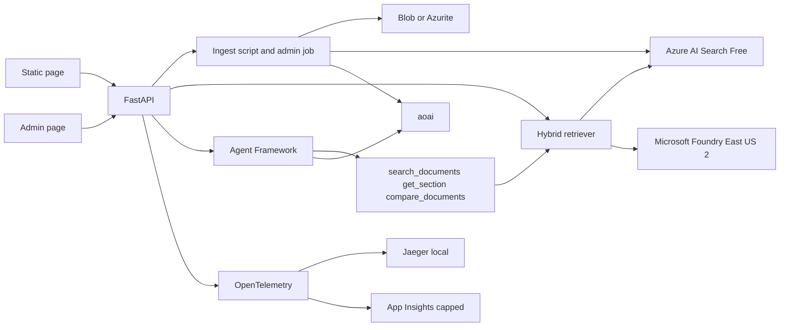

# DocPilot architecture

DocPilot is a document-agnostic assistant. A visitor asks a question in a browser or over HTTP. The service answers from whatever an admin has uploaded, or, for harder questions, calls tools through Microsoft Agent Framework. Every claim is cited. An eval harness gates pull requests. The running service is a container, local or on Azure Container Apps.

The target date for the whole build is **Thursday 15 October 2026**. Work is one sequenced day, not a Friday–Sunday split. Source PDFs live in Blob Storage account `stdocpilotprod`, container `sources`. The resource group name is a deploy-time value, kept outside git. Local Compose uses Azurite for the same container name.

[requirements.md](../requirements.md) is the source of truth. The README notes that [Microsoft Agent Framework](https://github.com/microsoft/agent-framework) is the successor to Semantic Kernel. The package is `agent-framework-core`.

## Who it is for

A visitor asking questions about the documents an admin has uploaded. Nothing in the product hard-codes a corpus. Answers are informational only. Public question answering stays anonymous. One admin password protects `/admin`, where documents can be listed, uploaded, replaced, and deleted. There are no public accounts and no per-document access control. Kubernetes and Databricks are out of scope. AKS is only a later scaling note.

## Shape



Two question paths share one retriever:

1. `POST /ask` runs retrieval and one grounded completion. The prompt is plain code, not a framework chain.
2. `POST /agent` runs Microsoft Agent Framework with three tools. The response includes the tool calls so the reasoning is auditable.

Ingestion is one path. An admin upload calls it. It parses PDFs, chunks them, embeds them, and upserts the index. Source files live in Blob Storage account `stdocpilotprod`, container `sources`. Compose uses Azurite with that same container name. The Container App reaches the account with its managed identity. When `AZURE_STORAGE_ACCOUNT_URL` is unset, `/admin` stores files under `DOCPILOT_DATA_DIR` (default `.data`) so documents can be uploaded before Compose is running.

## Repo layout

| Path | Role |
| --- | --- |
| `src/` | FastAPI app, retriever, prompts, agent |
| `ingest/` | PDF download, parse, chunk, embed, upsert |
| `eval/` | Golden questions, red-team prompts, the harness, and the LangChain baseline |
| `infra/` | Bicep |
| `tests/` | Unit tests. LLM and Search calls are mocked |
| `docs/` | Architecture, Docker primer, walkthrough, decision records |

## Ingestion and the index

The live corpus is whatever the admin uploads. Only public-domain or clearly reusable files are allowed. An upload that would pass the index limit for that deployment is refused. Whoever sets the deployment up chooses that limit.

Each chunk keeps the document title, section heading, and page number. A year is stored when the document has one. Chunks are about 500–800 tokens with overlap. Size and overlap are configuration. Chunk IDs are stable, so a re-run upserts instead of duplicating.

Embeddings use `text-embedding-3-small` at **512 dimensions**.

One Azure AI Search index, on the Free tier. East US 2 had no free-tier capacity on 14 October 2026, so the service `srch-docpilot-prod` is in East US, still inside the same resource group. Every other resource is in East US 2. Fields:

| Field | Use |
| --- | --- |
| `id` | Stable chunk ID, key |
| `content` | Chunk text, searchable |
| `content_vector` | 512-dimensional vector |
| `doc` | Document title, filterable |
| `year` | Year when the document has one, filterable |
| `section` | Section heading, filterable |
| `page` | Page number, filterable |

Retrieval is hybrid: keyword plus vector. Semantic ranker stays on the **free** allowance only. The query path tries it and, if the call fails or the allowance is exhausted, falls back to hybrid. The service must not switch semantic billing to the paid plan. There is one Free Search service allowed per subscription; if one already exists, provisioning stops and asks the owner.

## RAG question answering

`POST /ask` accepts `{ "question": "..." }` and returns `{ "answer", "citations": [{ "doc", "section", "page", "snippet" }], "trace_id" }`. A year is included when the source document has one.

The retriever is readable Python: hybrid search, top-k, optional semantic rerank. Context engineering is explicit: a limit on how much context is sent, deduplication, and a stable order. The prompt template is a versioned file in the repo. The model may answer only from that context, must cite every claim, and must say "not found in the documents" when the context does not support an answer.

`GET /health` and the OpenAPI page at `/docs` are required. A single static HTML page sends a question, shows the citations, and states that answers come from the uploaded documents and are informational only.

Public abuse protection applies to `/ask` and `/agent`: a per-IP rate limit, a maximum question length, and a global daily token cap. When the cap is hit, the response is a friendly "demo limit reached" message. The corpus is public-domain only.

## Admin

`/admin` and `/admin/api/*` require one admin password. The password hash is argon2id or bcrypt. It lives in Key Vault or a Container Apps secret, never in git. Login sets a signed session cookie: HttpOnly, Secure, SameSite, with an expiry. Localhost may omit Secure so Compose works over HTTP. Failed logins are rate-limited and lock out after repeated failures. Admin forms use CSRF protection. `/ask` and `/agent` stay anonymous.

The page lists each indexed document: title, source, year when the document has one, pages, chunk count, ingested date, and status. An admin can upload a PDF (size limit and PDF type check) or add one by URL. Ingestion runs in the API process and reports queued, processing, ready, or failed. The page shows how much text is indexed and refuses an upload that would pass the limit configured for that deployment.

Delete removes the source file and every chunk for that document. Replace indexes the new version first and removes the old chunks only after that succeeds. Every admin action writes an audit record of who, what, and when. The record does not include the password or the document body.

Tests cover anonymous access (401 or 403), delete, and replace.

## Agent

Package: `agent-framework-core`. Chat goes through `agent-framework-openai` to the Foundry account. Import: `agent_framework`. Confirm the current tool-calling API against the [Python package docs](https://github.com/microsoft/agent-framework/blob/main/python/README.md) before writing the agent. Do not install the entire `agent-framework` meta-package unless a missing integration requires it.

`POST /agent` returns the answer, citations, and each tool call (name, arguments, short result).

| Tool | Behavior |
| --- | --- |
| `search_documents(query, filters)` | Wraps the same retriever as `/ask` |
| `get_section(doc, section_id)` | Returns the full text of a cited section |
| `compare_documents(topic)` | Pulls what several uploaded documents say about one topic |

Guardrails: a maximum number of tool calls per request, a timeout, and a refusal for out-of-scope or unsafe requests. The same public limits as `/ask` apply: per-IP rate limit, maximum question length, and the daily token cap.

Before coding this story, confirm the current tool-calling API in the [Python package docs](https://github.com/microsoft/agent-framework/blob/main/python/README.md). Do not guess function names from Semantic Kernel.

A separate LangChain script, `eval/langchain_baseline.py`, answers the same golden set. The eval report compares accuracy, citation rate, latency, and tokens. LangChain is a baseline, not the production path.

## Evaluation

The golden file holds 30 questions with expected facts and expected documents or pages. CI runs that set, and it includes questions that need more than one document. Ten red-team prompts cover prompt injection, out-of-scope questions, system-prompt extraction, and invented citations. Expected behavior is to refuse, or to answer only from the documents.

Metrics: answer correctness (LLM-as-judge plus key-fact match), citation accuracy, groundedness, red-team pass rate, latency, and token cost. Thresholds live in config (starting point: correctness at least 0.8, citation accuracy at least 0.9, red-team 10/10). The harness exits non-zero when a threshold fails. `make eval` runs it locally. CI runs it on pull requests and publishes a Markdown and JSON report.

One pull request in history must show a deliberate regression (a broken prompt or a smaller top-k) turning CI red, followed by the fix. That is the regression proof.

## Observability

OpenTelemetry spans cover the API, retrieval, LLM calls, and agent tool calls. Spans carry token counts and latency. Logs are structured JSON and include `trace_id`. Secrets are never logged. Prompt bodies are not logged at info level.

Locally, Jaeger runs in Docker Compose. In Azure, traces export to Application Insights with a daily ingestion cap. Tracing can stay local-only, and that choice is written down.

## Engineering

Python 3.12, `uv` with a lockfile, `ruff` for lint and format, `mypy` for types, `pytest` for chunking, retrieval, prompt building, tool functions, admin auth, delete, and replace. Config is environment variables. `.env.example` is committed. `.env` is not. No secrets in git.

Branches, commits, and pull request titles include the Jira key `DOCPILOT-N`. Smart commits such as `DOCPILOT-12 #comment ...` are fine. Pull requests stay small.

## CI/CD

On a pull request: lint, typecheck, unit tests, Docker image build, eval harness against the thresholds, and Bicep validation once `infra/` exists.

On `main`: build the image, push it to GitHub Container Registry, and deploy to Azure Container Apps through a GitHub `production` environment that requires a reviewer. The workflow file can land before any deploy runs. Running the deploy waits for an explicit owner yes.

Sign-in from GitHub to Azure uses OIDC federated credentials. No cloud keys are stored in GitHub or in git.

## Azure

Resource group: chosen at deploy time, East US 2. The name is kept in the gitignored parameter file. Do not reuse an existing App Service plan.

Infrastructure is Bicep under `infra/`. The estate is Azure-only, and `az deployment group what-if` does not need a remote state account. Names look like `ais-docpilot-prod`, `srch-docpilot-prod`, `kv-docpilot-prod`, `ca-docpilot-prod`. The Foundry project is `docpilot-prod`. The storage account is `stdocpilotprod` because a storage account name cannot contain hyphens. The container is `sources`.

One Azure environment, `prod`, on the custom domain supplied at deploy time. Local Compose is dev. A second Azure environment and a dev subdomain wait until they are worth the extra surface. The Container App uses the Consumption plan and scales to zero replicas.

The app uses a managed identity for Microsoft Foundry, Blob Storage (`Storage Blob Data Contributor`), and, if the Free tier allows the data-plane role, Azure AI Search. Anything that cannot be a role assignment goes in Key Vault, including the admin password hash. The Bicep template declares the secret slot. The hash value is set outside git. If Free-tier Search rejects a data-plane role, the query key is stored in Key Vault and the exception is an ADR. Keys never go in git.

Custom domain: free managed certificate, HTTPS only. The deploy step prints two DNS records and stops:

- CNAME `docpilot` to the Container App hostname
- TXT `asuid.docpilot` with the verification ID

Binding the domain waits until the owner confirms those records exist.

Teardown is:

```bash
az group delete --name <resource-group>
```

The subscription and resource group are deploy-time values, kept outside git. Existing accounts in other resource groups are not reused. Subscription quota is checked at apply time.

### Region check

Checked against Microsoft's [Foundry region matrix](https://learn.microsoft.com/en-us/azure/foundry/foundry-models/concepts/models-sold-directly-by-azure-region-availability) on 14 October 2026. This is a catalog check, not a quota check on this subscription.

| Capability | East US 2 |
| --- | --- |
| `gpt-6.1-sol` version `2026-09-29` | Listed for Global Standard and Data Zone Standard |
| `text-embedding-3-small` version `1` | Listed, including Data Zone Standard |
| Azure AI Search | Free tier is offered in East US 2 |
| Blob Storage | Offered in East US 2 |
| Container Apps Consumption | Offered in East US 2 |
| Managed certificate | Offered with Container Apps custom domains |

Chat and the LLM judge both use `gpt-6.1-sol` so there is only one chat deployment. Deployment type is **Data Zone Standard (US)** so prompts and responses stay in the United States. Embeddings use the same deployment type at 512 dimensions.

## Decisions

| Topic | Choice |
| --- | --- |
| Users | A visitor over whatever documents an admin uploaded. Public Q&A is anonymous. One admin password. Answers are informational only |
| Corpus | No hard-coded set. The live corpus is whatever an admin uploads |
| Admin | Password hash in Key Vault, session cookie, CSRF, blob for source PDFs, in-process ingest jobs, audit log |
| Agent stack | `agent-framework-core`, not Semantic Kernel |
| Chat and judge | `gpt-6.1-sol` `2026-09-29`, Data Zone Standard (US) |
| Embeddings | `text-embedding-3-small`, 512 dimensions |
| Retrieval | Plain Python, hybrid, semantic ranker only on the free allowance |
| IaC | Bicep in `infra/` |
| Environments | Compose locally. One Azure app, `prod`, scale to zero |
| Registry | GHCR |
| Cloud auth | Managed identity, Key Vault fallback, GitHub OIDC |
| Tracing | Jaeger locally, capped Application Insights in Azure |
| Schedule | All stories due Thursday 15 October 2026, in dependency order |
| Spend | No Azure create until the owner says yes |

## Docker, for this project

Docker is how the API and Jaeger run the same way on a laptop and in CI. The terms below are the ones this repo uses. A longer primer lands in `docs/docker.md`.

An **image** is a stacked snapshot of a filesystem plus the command that starts the process. Each instruction in a Dockerfile adds a layer. A **container** is a running process created from an image. You can start many containers from one image. Deleting a container does not delete the image.

The **Dockerfile** is the recipe. This project uses a **multi-stage** build. The first stage installs compilers and resolves Python dependencies. The second stage starts from a slim Python image and copies only the virtual environment and the application. Build tools never ship, so the image is smaller and has less to patch.

The process inside the image runs as a **non-root** user. A bug in the app then does not start as the administrator of the container.

**Compose** is a file that starts more than one container together. Here that is the API, Jaeger, and Azurite, on a private network only they share. The API reaches Jaeger by the service name `jaeger`, and Azurite by the service name `azurite`, not by localhost inside the container. Publishing `8000:8000` maps port 8000 on your machine to port 8000 in the API container. That published port is the only way in from the laptop.

Secrets and endpoints come from environment variables at start time (the Compose `env_file`, or Container Apps settings). They are not copied into image layers. A layer is forever in that image; a secret baked into one is a leaked secret.

Nothing in the image build is allowed to call Azure. The container starts without cloud credentials and still serves `/health`.

## Definition of done

Code and tests are merged through a pull request. CI is green. Evals are at or above the configured thresholds when the change touches answering behavior. Bicep or docs are updated when the change touches them. The Jira story is closed.
