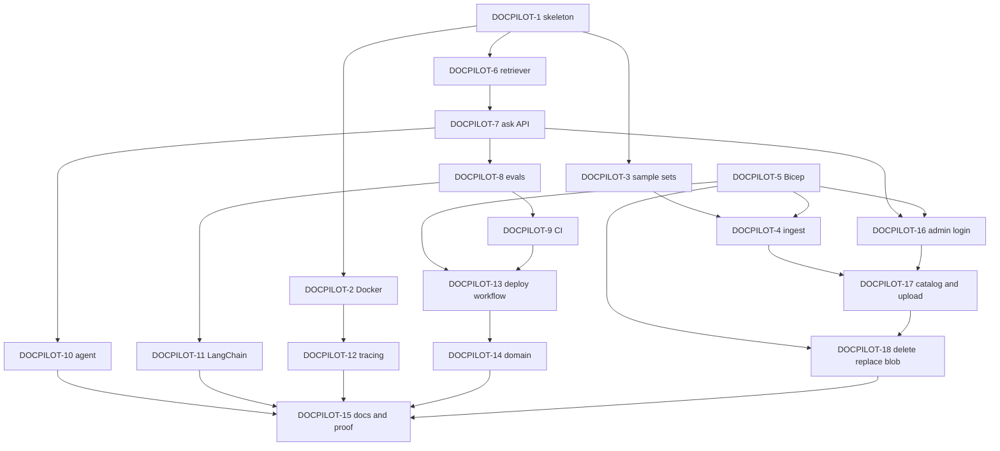

# DocPilot technical plan

The whole build is due **Thursday 15 October 2026**. The eighteen stories below are one Thursday sequence in dependency order, not a Friday–Sunday split. Architecture is in [architecture.md](architecture.md).

Sample PDFs live in git so an admin can upload them by hand. They are excluded from the image and are not loaded into the running app. Blob Storage for those source files is part of the deployed stack.

## Definition of done

For every story: code and tests merged through a pull request, CI green, evals at or above threshold when answering behavior changes, Bicep or docs updated when the change touches them, and the Jira story closed. Branch names, commits, and pull request titles include the key `DOCPILOT-N`.

## Order

Stories are implemented in key order, skipping ahead only when the dependency list allows it. All of them are due the same day.

`DOCPILOT-5` blocks the live index upload inside `DOCPILOT-4`, the live admin password secret inside `DOCPILOT-16`, the live blob inside `DOCPILOT-18`, and `DOCPILOT-13`. Chunking unit tests in `DOCPILOT-4` do not wait on Azure. `DOCPILOT-10`, `DOCPILOT-11`, `DOCPILOT-12`, `DOCPILOT-14`, and `DOCPILOT-18` block `DOCPILOT-15`.

## Stories

Stories are on the [DOCPILOT board](https://nitro.atlassian.net/jira/software/projects/DOCPILOT/board). Each one is labeled `thursday` and due 2026-10-15. Blocks links match the diagram above.

### DOCPILOT-1 — Python 3.12 skeleton

Due Thursday 15 October 2026.

`uv` lockfile, ruff, mypy, pytest, and the directories `src/`, `ingest/`, `eval/`, `infra/`, `tests/`, and `docs/`. Commit `.env.example`. Do not commit `.env`.

Blocks: DOCPILOT-2, DOCPILOT-3, DOCPILOT-6.

### DOCPILOT-2 — Docker image, Compose, and primer

Due Thursday 15 October 2026.

Multi-stage Dockerfile, non-root user, Compose for the API plus Jaeger, and `docs/docker.md`. The API publishes port 8000. Secrets come from the environment, not from image layers.

Blocked by DOCPILOT-1. Blocks DOCPILOT-12.

### DOCPILOT-3 — Sample sets and seed command

Due Thursday 15 October 2026.

DocPilot does not hard-code a corpus. Commit `sample-docs/{irs,nps,fema,ssa-medicare}/` with a `SOURCES.md` (title, URL, date or tax year, license note) and the sample PDFs. The PDFs stay out of the image. An admin uploads the ones to try. `make seed SET=irs` uses the same ingestion path when a local run needs the IRS set. CI evals use that set.

Blocked by DOCPILOT-1. Blocks DOCPILOT-4.

### DOCPILOT-4 — Ingestion

Due Thursday 15 October 2026.

Parse PDFs, keep title, section, and page, chunk at 500–800 tokens with configurable overlap, embed with `text-embedding-3-small` at 512 dimensions, and upsert a hybrid index with stable chunk IDs. This is the only ingest path. Admin uploads and `make seed` both use it. Unit tests mock the network. The live upload waits until an index exists.

Blocked by DOCPILOT-3. Live upload is also blocked by DOCPILOT-5.

### DOCPILOT-5 — Bicep, no apply

Due Thursday 15 October 2026.

Bicep for Azure AI Search Free, Microsoft Foundry (`ais-docpilot-prod`, project `docpilot-prod`), Key Vault, Blob Storage for source PDFs, Container Apps Consumption, a $10 budget alert, and the GitHub OIDC app, in the DocPilot resource group, East US 2. Key Vault has a slot for the admin password hash. The hash value is not in git or in the template. Blob Storage is account `stdocpilotprod`, container `sources`, with Storage Blob Data Contributor on the Container App identity. Subscription, domain, and alert email stay in the gitignored parameter file.

Blocks the live index use inside DOCPILOT-4, and blocks DOCPILOT-13.

### DOCPILOT-6 — Hybrid retriever and prompt

Due Thursday 15 October 2026.

Plain-code hybrid search, top-k, a token budget, deduplication, ordering, and a versioned prompt template. Semantic ranker stays on the free allowance and is skipped when the call fails.

Blocked by DOCPILOT-1. Blocks DOCPILOT-7.

### DOCPILOT-7 — Ask API and static page

Due Thursday 15 October 2026.

`POST /ask` returns the answer, citations (`doc`, `section`, `page`, `snippet`), and `trace_id`. `GET /health` and `/docs`. One static page shows the citations and a disclaimer that answers come from the uploaded documents and are informational only. Grounded answers only. Unsupported questions say "not found in the documents". Per-IP rate limiting, a maximum question length, and a global daily token cap return "demo limit reached" when the cap is hit. The same limits cover `/agent`.

Blocked by DOCPILOT-6. Blocks DOCPILOT-8 and DOCPILOT-10.

### DOCPILOT-8 — Eval harness

Due Thursday 15 October 2026.

Thirty golden questions in `eval/irs/golden.jsonl` and ten red-team prompts. Other sample sets use `eval/<set>/golden.jsonl`. The IRS golden set includes questions that need more than one document. Metrics: correctness, citation accuracy, groundedness, red-team pass rate, latency, and token cost. Thresholds in config. Non-zero exit on failure. Markdown and JSON reports. CI runs the IRS set.

Blocked by DOCPILOT-7. Blocks DOCPILOT-9 and DOCPILOT-11.

### DOCPILOT-9 — Pull request CI

Due Thursday 15 October 2026.

GitHub Actions on pull requests: lint, typecheck, unit tests, Docker build, and the eval gate against `eval/irs/golden.jsonl`.

Blocked by DOCPILOT-8. Blocks DOCPILOT-13.

### DOCPILOT-10 — Agent and tools

Due Thursday 15 October 2026.

`POST /agent` on `agent-framework-core`. Confirm the tool-calling API from the official Python docs before coding. Do not reuse Semantic Kernel names. Tools: `search_documents`, `get_section`, `compare_documents` (what several uploaded documents say about one topic, for example home office rules in IRS Pub 587 and Pub 334). Return tool calls. Cap tool calls, enforce a timeout, and refuse out-of-scope or unsafe requests. Honor the rate limit, question-length limit, and daily token cap from DOCPILOT-7.

Blocked by DOCPILOT-7. Blocks DOCPILOT-15.

### DOCPILOT-11 — LangChain baseline

Due Thursday 15 October 2026.

`eval/langchain_baseline.py` answers the same golden set. The report compares accuracy, citation rate, latency, and tokens.

Blocked by DOCPILOT-8. Blocks DOCPILOT-15.

### DOCPILOT-12 — Tracing and logs

Due Thursday 15 October 2026.

OpenTelemetry spans for the API, retrieval, LLM calls, and agent tools, with token counts and latency. JSON logs with `trace_id`. No secrets and no prompt bodies at info level. Jaeger is already in Compose.

Blocked by DOCPILOT-2. Blocks DOCPILOT-15.

### DOCPILOT-13 — Image publish and deploy workflow

Due Thursday 15 October 2026.

On `main`, build and push to GitHub Container Registry, then deploy with OIDC behind the GitHub `production` environment. The workflow file can merge. Running the deploy waits for owner approval. No Azure Container Registry.

Blocked by DOCPILOT-5 and DOCPILOT-9. Blocks DOCPILOT-14.

### DOCPILOT-14 — Custom domain handoff

Due Thursday 15 October 2026.

Print the CNAME and TXT records for the custom domain. Bind the managed certificate only after the owner confirms DNS. The production hostname is a deploy-time value, kept outside git.

Blocked by DOCPILOT-13. Blocks DOCPILOT-15.

### DOCPILOT-15 — README, walkthrough, ADRs, regression proof

Due Thursday 15 October 2026.

README with a diagram, local and Azure quickstart, eval table, design tradeoffs, cost, teardown (`az group delete --name <resource-group>`), the admin page, and a note that Cursor was used. `docs/walkthrough.md` is a 5–7 minute script. Short ADRs for Container Apps, plain-code retrieval, and Agent Framework plus the LangChain comparison. One historical pull request fails eval on purpose and is then fixed.

Blocked by DOCPILOT-10, DOCPILOT-11, DOCPILOT-12, DOCPILOT-14, and DOCPILOT-18.

### DOCPILOT-16 — Admin login

Due Thursday 15 October 2026.

`/admin` and `/admin/api/*` behind one admin password. The hash is argon2id or bcrypt, stored as a Key Vault or Container Apps secret, never in git. If neither the hash nor the session secret is set, the first visitor to `/admin/login` chooses the password. The app stores the argon2id hash and a generated session secret in blob storage when Azure storage is configured, otherwise under the local data directory, and does not store the password. Login sets a signed, HttpOnly, Secure, SameSite session cookie with an expiry. Localhost may omit Secure so Compose works over HTTP. Failed logins are rate-limited and lock out after repeated failures. Admin forms use CSRF protection. Public `/ask` and `/agent` stay anonymous. Tests: an anonymous caller gets 401 or 403 on admin routes.

Blocked by DOCPILOT-7. The live password secret is also blocked by DOCPILOT-5. Blocks DOCPILOT-17.

### DOCPILOT-17 — Admin catalog, upload, and capacity

Due Thursday 15 October 2026.

List indexed documents: title, source, year when present, pages, chunk count, ingested date, status. Upload a PDF with a size limit and a PDF type check, or add a document by URL. The PDF is confirmed in blob storage before the catalog record is written. Ingestion then runs in the API process as a background job with status queued, processing, ready, or failed, on the same path as `make seed`. The page shows index size against the 50 MB Free-tier limit and blocks an upload that would exceed it. [DOCPILOT-19](https://nitro.atlassian.net/browse/DOCPILOT-19) is the bug where the catalog was written before that confirmation.

Blocked by DOCPILOT-16 and DOCPILOT-4. Blocks DOCPILOT-18.

### DOCPILOT-18 — Delete, replace, blob storage, and audit

Due Thursday 15 October 2026.

Delete removes the source file and every chunk for that document. Replace stores and confirms the new PDF, then re-ingests it and removes the old chunks only after the new ones are indexed. Source PDFs live in Azure Blob Storage. Compose uses Azurite. Every admin action is an audit record: who, what, when, with no password and no document body. Tests cover delete and replace. [DOCPILOT-19](https://nitro.atlassian.net/browse/DOCPILOT-19) requires the blob write to be confirmed before the catalog record is created.

Blocked by DOCPILOT-17. Live blob is also blocked by DOCPILOT-5. Blocks DOCPILOT-15.

### DOCPILOT-19 — Store the PDF before cataloging it

Found Thursday 15 October 2026.

Bug. Admin upload wrote a catalog record before the PDF was stored. Indexing, including embeddings, ran while `sources/documents/{id}.pdf` did not exist. A slow or failed ingest left a catalog entry and no file.

Store the PDF and confirm the object size. Write the catalog record only after that confirmation. A failed upload or failed confirmation leaves no catalog record. Extraction, chunking, embeddings, and index upsert run after the file is confirmed. A later ingest failure keeps the stored PDF and the catalog entry, and marks the entry failed.

### DOCPILOT-20 — Reset the catalog from admin

Found Thursday 15 October 2026.

A Reset catalog action deletes every source PDF, catalog record, audit event, and search chunk after a Yes or No confirmation. Yes leaves the audit log empty. The admin password store stays.

### DOCPILOT-21 — Reset the admin password

Found Thursday 15 October 2026.

A signed-in admin opens a page and sets a new password. The hash is replaced. The password is not stored. The current session stays valid.

### DOCPILOT-22 — Read title and year from the PDF

Found Thursday 15 October 2026.

Remove Title and Year from the upload, URL, and replace forms. Ingest reads them from the PDF metadata and text. Upload and seed use the same reading.

### DOCPILOT-23 — Add the public header to admin

Found Thursday 15 October 2026.

Admin pages use the public navy header, the existing `assets/logo.svg` mark, and the DocPilot name. The same file is the favicon.

### DOCPILOT-24 — Use gpt-6.1-sol for chat and the judge

Found Thursday 15 October 2026.

Chat and the LLM judge use one Foundry deployment, `gpt-6.1-sol` version `2026-09-29`, Data Zone Standard (US), capacity 50. Embeddings stay `text-embedding-3-small` at 512 dimensions. Public `/ask` and `/agent` keep the daily token cap as the spend throttle.

## Issue index

| Key | Summary | Due | URL |
| --- | --- | --- | --- |
| DOCPILOT-1 | Python 3.12 skeleton | 2026-10-15 | https://nitro.atlassian.net/browse/DOCPILOT-1 |
| DOCPILOT-2 | Docker image, Compose, and primer | 2026-10-15 | https://nitro.atlassian.net/browse/DOCPILOT-2 |
| DOCPILOT-3 | Sample sets and seed command | 2026-10-15 | https://nitro.atlassian.net/browse/DOCPILOT-3 |
| DOCPILOT-4 | Ingestion | 2026-10-15 | https://nitro.atlassian.net/browse/DOCPILOT-4 |
| DOCPILOT-5 | Bicep, no apply | 2026-10-15 | https://nitro.atlassian.net/browse/DOCPILOT-5 |
| DOCPILOT-6 | Hybrid retriever and prompt | 2026-10-15 | https://nitro.atlassian.net/browse/DOCPILOT-6 |
| DOCPILOT-7 | Ask API and static page | 2026-10-15 | https://nitro.atlassian.net/browse/DOCPILOT-7 |
| DOCPILOT-8 | Eval harness | 2026-10-15 | https://nitro.atlassian.net/browse/DOCPILOT-8 |
| DOCPILOT-9 | Pull request CI | 2026-10-15 | https://nitro.atlassian.net/browse/DOCPILOT-9 |
| DOCPILOT-10 | Agent and tools | 2026-10-15 | https://nitro.atlassian.net/browse/DOCPILOT-10 |
| DOCPILOT-11 | LangChain baseline | 2026-10-15 | https://nitro.atlassian.net/browse/DOCPILOT-11 |
| DOCPILOT-12 | Tracing and logs | 2026-10-15 | https://nitro.atlassian.net/browse/DOCPILOT-12 |
| DOCPILOT-13 | Image publish and deploy workflow | 2026-10-15 | https://nitro.atlassian.net/browse/DOCPILOT-13 |
| DOCPILOT-14 | Custom domain handoff | 2026-10-15 | https://nitro.atlassian.net/browse/DOCPILOT-14 |
| DOCPILOT-15 | README, walkthrough, ADRs, regression proof | 2026-10-15 | https://nitro.atlassian.net/browse/DOCPILOT-15 |
| DOCPILOT-16 | Admin login | 2026-10-15 | https://nitro.atlassian.net/browse/DOCPILOT-16 |
| DOCPILOT-17 | Admin catalog, upload, and capacity | 2026-10-15 | https://nitro.atlassian.net/browse/DOCPILOT-17 |
| DOCPILOT-18 | Delete, replace, blob storage, and audit | 2026-10-15 | https://nitro.atlassian.net/browse/DOCPILOT-18 |
| DOCPILOT-19 | Store the PDF before cataloging it | 2026-10-15 | https://nitro.atlassian.net/browse/DOCPILOT-19 |
| DOCPILOT-20 | Reset the catalog from admin | 2026-10-15 | https://nitro.atlassian.net/browse/DOCPILOT-20 |
| DOCPILOT-21 | Reset the admin password | 2026-10-15 | https://nitro.atlassian.net/browse/DOCPILOT-21 |
| DOCPILOT-22 | Read title and year from the PDF | 2026-10-15 | https://nitro.atlassian.net/browse/DOCPILOT-22 |
| DOCPILOT-23 | Add the public header to admin | 2026-10-15 | https://nitro.atlassian.net/browse/DOCPILOT-23 |
| DOCPILOT-24 | Use gpt-6.1-sol for chat and the judge | 2026-10-15 | https://nitro.atlassian.net/browse/DOCPILOT-24 |
