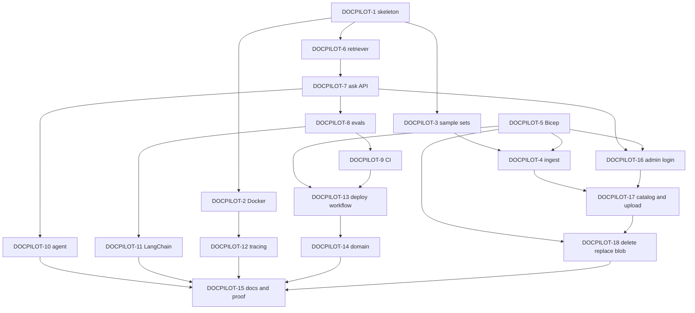

# DocPilot technical plan

The whole build is due **Thursday 15 October 2026**. The eighteen stories below are one Thursday sequence in dependency order, not a Friday–Sunday split. Architecture is in [architecture.md](architecture.md).

The app does not load a corpus on startup. An admin uploads PDFs. Uploaded files stay out of the image. Blob Storage for those source files is part of the deployed stack.

## Definition of done

For every story: code and tests merged through a pull request, CI green, a live eval against one environment's index when answering behavior changes (that report belongs to that environment), Bicep or docs updated when the change touches them, and the Jira story closed. Branch names, commits, and pull request titles include the key `DOCPILOT-N`.

## Order

Stories are implemented in key order, skipping ahead only when the dependency list allows it. All of them are due the same day.

`DOCPILOT-5` blocks the live index upload inside `DOCPILOT-4`, the live admin password secret inside `DOCPILOT-16`, the live blob inside `DOCPILOT-18`, and `DOCPILOT-13`. Chunking unit tests in `DOCPILOT-4` do not wait on Azure. `DOCPILOT-10`, `DOCPILOT-11`, `DOCPILOT-12`, `DOCPILOT-14`, and `DOCPILOT-18` block `DOCPILOT-15`.

## Stories

Stories are on the [DOCPILOT board](https://nitro.atlassian.net/jira/software/projects/DOCPILOT/board). Each one is labeled `thursday` and due 2026-10-15. Blocks links match the diagram above.

### DOCPILOT-1 — Python 3.12 skeleton

Due Thursday 15 October 2026.

`uv` lockfile, ruff, mypy, pytest, and the directories `src/`, `ingest/`, `eval/`, `infra/`, `tests/`, and `docs/`. Commit `.env.example`. Do not commit `.env`.

Blocks: DOCPILOT-2, DOCPILOT-3, DOCPILOT-6.

### DOCPILOT-2 — Docker image, Compose, and primer

Due Thursday 15 October 2026.

Multi-stage Dockerfile, non-root user, Compose for the API plus Jaeger, and `docs/docker.md`. The API publishes port 8000. Secrets come from the environment, not from image layers.

Blocked by DOCPILOT-1. Blocks DOCPILOT-12.

### DOCPILOT-3 — Sample sets and seed command

Due Thursday 15 October 2026.

DocPilot does not hard-code a corpus. The live set is whatever an admin uploads. A local seed command, when one is used, calls the same ingestion path as an admin upload. A live eval scores a question file only against one environment's index, and only when that file's documents are what was indexed there.

Blocked by DOCPILOT-1. Blocks DOCPILOT-4.

### DOCPILOT-4 — Ingestion

Due Thursday 15 October 2026.

Parse PDFs, keep title, section, and page, chunk at 500–800 tokens with configurable overlap, embed with `text-embedding-3-small` at 512 dimensions, and upsert a hybrid index with stable chunk IDs. This is the only ingest path. Admin uploads and `make seed` both use it. Unit tests mock the network. The live upload waits until an index exists.

Blocked by DOCPILOT-3. Live upload is also blocked by DOCPILOT-5.

### DOCPILOT-5 — Bicep, no apply

Due Thursday 15 October 2026.

Bicep for Azure AI Search Free, Microsoft Foundry (`ais-docpilot-prod`, project `docpilot-prod`), Key Vault, Blob Storage for source PDFs, Container Apps Consumption, and the GitHub OIDC app, in the DocPilot resource group, East US 2. Key Vault has a slot for the admin password hash. The hash value is not in git or in the template. Blob Storage is account `stdocpilotprod`, container `sources`, with Storage Blob Data Contributor on the Container App identity. Subscription and domain stay in the gitignored parameter file.

Blocks the live index use inside DOCPILOT-4, and blocks DOCPILOT-13.

### DOCPILOT-6 — Hybrid retriever and prompt

Due Thursday 15 October 2026.

Plain-code hybrid search, top-k, a limit on retrieved context, deduplication, ordering, and a versioned prompt template. Semantic ranker stays on the free allowance and is skipped when the call fails.

Blocked by DOCPILOT-1. Blocks DOCPILOT-7.

### DOCPILOT-7 — Ask API and static page

Due Thursday 15 October 2026.

`POST /ask` returns the answer, citations (`doc`, `section`, `page`, `snippet`), and `trace_id`. `GET /health` and `/docs`. One static page shows the citations and a disclaimer that answers come from the uploaded documents and are informational only. Grounded answers only. Unsupported questions say "not found in the documents". Per-IP rate limiting, a maximum question length, and a global daily token cap return "demo limit reached" when the cap is hit. The same limits cover `/agent`.

Blocked by DOCPILOT-6. Blocks DOCPILOT-8 and DOCPILOT-10.

### DOCPILOT-8 — Eval harness

Due Thursday 15 October 2026.

Thirty golden questions and ten red-team prompts. The golden set includes questions that need more than one document. Metrics: correctness, citation accuracy, groundedness, red-team pass rate, latency, and tokens. Thresholds in config. Non-zero exit on failure. Markdown and JSON reports. A live eval runs that set against one environment's index. DOCPILOT-58 removed it from pull-request CI.

Blocked by DOCPILOT-7. Blocks DOCPILOT-9 and DOCPILOT-11.

### DOCPILOT-9 — Pull request CI

Due Thursday 15 October 2026.

GitHub Actions on pull requests: lint, typecheck, unit tests, the Bicep build, and the Docker build. DOCPILOT-58 removed the eval gate against the golden question file.

Blocked by DOCPILOT-8. Blocks DOCPILOT-13.

### DOCPILOT-10 — Agent and tools

Due Thursday 15 October 2026.

`POST /agent` on `agent-framework-core`. Confirm the tool-calling API from the official Python docs before coding. Do not reuse Semantic Kernel names. Tools: `search_documents`, `get_section`, `compare_documents` (what several uploaded documents say about one topic). Return tool calls. Cap tool calls, enforce a timeout, and refuse out-of-scope or unsafe requests. Honor the rate limit, question-length limit, and daily token cap from DOCPILOT-7.

Blocked by DOCPILOT-7. Blocks DOCPILOT-15.

### DOCPILOT-11 — LangChain baseline

Due Thursday 15 October 2026.

`eval/langchain_baseline.py` answers the same golden set. The report compares accuracy, citation rate, latency, and tokens.

Blocked by DOCPILOT-8. Blocks DOCPILOT-15.

### DOCPILOT-12 — Tracing and logs

Due Thursday 15 October 2026.

OpenTelemetry spans for the API, retrieval, LLM calls, and agent tools, with token counts and latency. JSON logs with `trace_id`. No secrets and no prompt bodies at info level. Jaeger is already in Compose.

Blocked by DOCPILOT-2. Blocks DOCPILOT-15.

### DOCPILOT-13 — Image publish and deploy workflow

Due Thursday 15 October 2026.

On `main`, build and push to GitHub Container Registry, then deploy with OIDC behind the GitHub `production` environment. The workflow file can merge. Running the deploy waits for owner approval. No Azure Container Registry.

Blocked by DOCPILOT-5 and DOCPILOT-9. Blocks DOCPILOT-14.

### DOCPILOT-14 — Custom domain handoff

Due Thursday 15 October 2026.

Print the CNAME and TXT records for the custom domain. Bind the managed certificate only after the owner confirms DNS. The production hostname is a deploy-time value, kept outside git.

Blocked by DOCPILOT-13. Blocks DOCPILOT-15.

### DOCPILOT-15 — README, walkthrough, ADRs, regression proof

Due Thursday 15 October 2026.

README with a diagram, local and Azure quickstart, eval table, design tradeoffs, teardown (`az group delete --name <resource-group>`), the admin page, and a note that Cursor was used. `docs/walkthrough.md` is a 5–7 minute script. Short ADRs for Container Apps, plain-code retrieval, and Agent Framework plus the LangChain comparison. One historical pull request fails eval on purpose and is then fixed.

Blocked by DOCPILOT-10, DOCPILOT-11, DOCPILOT-12, DOCPILOT-14, and DOCPILOT-18.

### DOCPILOT-16 — Admin login

Due Thursday 15 October 2026.

`/admin` and `/admin/api/*` behind one admin password. The hash is argon2id or bcrypt, stored as a Key Vault or Container Apps secret, never in git. If neither the hash nor the session secret is set, the first visitor to `/admin/login` chooses the password. The app stores the argon2id hash and a generated session secret in blob storage when Azure storage is configured, otherwise under the local data directory, and does not store the password. Login sets a signed, HttpOnly, Secure, SameSite session cookie with an expiry. Localhost may omit Secure so Compose works over HTTP. Failed logins are rate-limited and lock out after repeated failures. Admin forms use CSRF protection. Public `/ask` and `/agent` stay anonymous. Tests: an anonymous caller gets 401 or 403 on admin routes.

Blocked by DOCPILOT-7. The live password secret is also blocked by DOCPILOT-5. Blocks DOCPILOT-17.

### DOCPILOT-17 — Admin catalog, upload, and capacity

Due Thursday 15 October 2026.

List indexed documents: title, source, year when present, pages, chunk count, ingested date, status. Upload a PDF with a size limit and a PDF type check, or add a document by URL. The PDF is confirmed in blob storage before the catalog record is written. Ingestion then runs in the API process as a background job with status queued, processing, ready, or failed, on the same path as `make seed`. The page shows how much text is indexed and blocks an upload that would pass the limit configured for that deployment. [DOCPILOT-19](https://nitro.atlassian.net/browse/DOCPILOT-19) is the bug where the catalog was written before that confirmation.

Blocked by DOCPILOT-16 and DOCPILOT-4. Blocks DOCPILOT-18.

### DOCPILOT-18 — Delete, replace, blob storage, and audit

Due Thursday 15 October 2026.

Delete removes the source file and every chunk for that document. Replace stores and confirms the new PDF, then re-ingests it and removes the old chunks only after the new ones are indexed. Source PDFs live in Azure Blob Storage. Compose uses Azurite. Every admin action is an audit record: who, what, when, with no password and no document body. Tests cover delete and replace. [DOCPILOT-19](https://nitro.atlassian.net/browse/DOCPILOT-19) requires the blob write to be confirmed before the catalog record is created.

Blocked by DOCPILOT-17. Live blob is also blocked by DOCPILOT-5. Blocks DOCPILOT-15.

### DOCPILOT-19 — Store the PDF before cataloging it

Found Thursday 15 October 2026.

Bug. Admin upload wrote a catalog record before the PDF was stored. Indexing, including embeddings, ran while `sources/documents/{id}.pdf` did not exist. A slow or failed ingest left a catalog entry and no file.

Store the PDF and confirm the object size. Write the catalog record only after that confirmation. A failed upload or failed confirmation leaves no catalog record. Extraction, chunking, embeddings, and index upsert run after the file is confirmed. A later ingest failure keeps the stored PDF and the catalog entry, and marks the entry failed.

### DOCPILOT-20 — Reset the catalog from admin

Found Thursday 15 October 2026.

A Reset catalog action deletes every source PDF, catalog record, audit event, and search chunk after a Yes or No confirmation. Yes leaves the audit log empty. The admin password store stays.

### DOCPILOT-21 — Reset the admin password

Found Thursday 15 October 2026.

A signed-in admin opens a page and sets a new password. The hash is replaced. The password is not stored. The current session stays valid.

### DOCPILOT-22 — Read title and year from the PDF

Found Thursday 15 October 2026.

Remove Title and Year from the upload, URL, and replace forms. A title is stored only when the PDF metadata has one. A year is stored only when that title contains one. Otherwise both stay empty. The file name is not used as a title, and a year printed in the body is not guessed. Upload and seed use the same reading. The catalog shows an em dash for an empty title or year.

### DOCPILOT-23 — Add the public header to admin

Found Thursday 15 October 2026.

Admin pages use the public navy header, the existing `assets/logo.svg` mark, and the DocPilot name. The same file is the favicon.

### DOCPILOT-24 — Use gpt-6.1-sol for chat and the judge

Found Thursday 15 October 2026.

Chat and the LLM judge use one Foundry deployment, `gpt-6.1-sol` version `2026-09-29`, Data Zone Standard (US), capacity 50. Embeddings stay `text-embedding-3-small` at 512 dimensions. Public `/ask` and `/agent` keep the daily token cap as the spend throttle.

### DOCPILOT-25 — Keep admin messages out of the address bar

Found Thursday 15 October 2026.

Admin success and error messages are not query parameters. A redirect carries the message in a short-lived HttpOnly cookie, the next page shows it once, and the address bar stays `/admin` or `/admin/login`. A refresh shows nothing. [DOCPILOT-33](https://nitro.atlassian.net/browse/DOCPILOT-33) clears that message after a few seconds and does not keep it on screen while a document is still queued or processing. JSON clients still get the JSON body.

### DOCPILOT-26 — Export PNG copies of the logo

Found Thursday 15 October 2026.

Export `assets/logo.png` from `assets/logo.svg` and `assets/logo-mark.png` from `assets/logo-mark.svg`. Render the existing SVG files. Do not redraw the mark. The tile keeps the navy square. The mark stays on a transparent background.

### DOCPILOT-27 — Remove the Add by URL form

Found Thursday 15 October 2026.

The admin documents page does not show the Add by URL form: the heading, the URL field, and the Add URL button. `POST /admin/api/documents/url` stays so a client can still add a PDF by URL. `download_pdf` and the route stay.

### DOCPILOT-28 — Upload from a file picker or a drop zone

Found Thursday 15 October 2026.

On the admin documents page, a PDF can be chosen with the file picker or dropped onto a drop zone. Choosing or dropping a PDF uploads it immediately. There is no Upload button. The page shows the chosen filename and a busy or error state. Keep `POST /admin/api/documents`. Title and Year fields are already gone. The Add by URL form is already gone. Do not bring either back. Catalog and audit JSON files are replaced in one step, so the documents page can render while an upload is still being written.

### DOCPILOT-29 — Add an Admin menu to the header

Found Thursday 15 October 2026.

A signed-in admin header has an Admin menu on the right: Documents, Reset Catalog, Change Password, and Sign Out. Documents opens `/admin`. Sign Out posts the existing logout. The sign-in page has no menu. The documents page no longer has its own Password, Sign out, or Reset catalog controls.

### DOCPILOT-30 — Add Cancel to the change-password page

Found Thursday 15 October 2026.

The change-password page has a Cancel control next to Update password. Cancel returns to `/admin` and does not change the password.

### DOCPILOT-31 — Name the admin header and simplify the login page

Found Thursday 15 October 2026.

The admin header says DocPilot Admin. The login page heading is Login. The line under it is Manage source documents.

### DOCPILOT-32 — Reject an upload that would pass the index limit

Found Thursday 15 October 2026.

File upload and add-by-URL share one processing path. During that request, after the PDF is stored, the text is extracted and compared with the index limit. If the document would pass the limit, the stored PDF and its catalog record are deleted and the browser gets an error. Embeddings and the search upsert do not run. A later indexing failure still keeps the stored PDF.

### DOCPILOT-33 — Show upload progress and clear page messages

Found Thursday 15 October 2026.

Every admin form submits with an async request. The browser does not post a form as a page navigation. Upload, replace, delete, reset, password change, sign-in, setup, and sign-out stay on the current page until the response arrives. A success that opens another admin page loads that page with a GET. A failure, including a connection reset, shows the error on the current page.

The drop zone says Uploading only while the file is being sent, and a progress bar advances during that send so the control does not look frozen. Once the file has been sent, the bar keeps moving and the message changes to show that the file was received and work is still running, until the response arrives. A success clears the drop zone. The catalog, usage meter, and audit log update in place, including while a document is queued or processing. Notices and errors on the page disappear after a few seconds. The documents page does not reload itself to keep a notice on screen.

### DOCPILOT-34 — Load catalog, audit, and usage on their own

Found Thursday 15 October 2026.

The documents page renders its shell first. The catalog, the audit log, and the usage numbers (extracted text and source files stored) each load from their own request, including the first visit. One panel does not wait on another. The page no longer refreshes those panels by fetching the whole documents page and swapping the HTML.

Blocks DOCPILOT-35 and DOCPILOT-36.

### DOCPILOT-35 — Refresh catalog, audit, and usage while indexing

Found Thursday 15 October 2026.

While any document is queued or processing, the catalog, the audit log, and the usage numbers refresh every few seconds. Status, pages, chunks, errors, new audit rows, extracted text, and source-file totals change without a reload. When nothing is queued or processing, this fast refresh stops. Each panel is refreshed from its own read.

Blocked by DOCPILOT-34. Blocks DOCPILOT-36.

### DOCPILOT-36 — Refresh the documents panels every 30 seconds

Found Thursday 15 October 2026.

When the fast indexing refresh is not running, the catalog, the audit log, and the usage numbers still refresh every 30 seconds. A change from another session, or indexing that finished between visits, shows up without a manual reload. Each panel is refreshed from its own read.

Blocked by DOCPILOT-34 and DOCPILOT-35.

### DOCPILOT-37 — Add a Catalog Summary on the admin documents page

Found Thursday 15 October 2026.

Under the catalog, a Catalog Summary section has a Title field, a Summary field, and Sample questions as three text fields. They load blank until an admin saves them.

Save Changes is the only button at the bottom. It stays disabled until a field differs from the last saved values. It submits asynchronously, stays on the page, tells the admin the summary was saved, and that notice disappears after a moment. The address bar stays clean.

A control at the top of the form fills the title, the summary, and the three sample questions from the indexed documents. Generation does not save. The admin still presses Save Changes.

The title states what the documents have in common. The summary says what the set contains, so a visitor knows what to ask. The three questions are ones those documents can answer. The wording comes from the documents that are indexed, not from a fixed corpus.

The title, summary, and three questions are one catalog summary record, stored beside the catalog and cleared when the catalog is reset. Saving writes an audit event and does not put the summary text in that event. An anonymous caller cannot read or change the record.

Auto-complete reads the text of ready documents, asks the chat model for the title, the summary, and three questions those documents can answer, and fills the form. It does not save.

### DOCPILOT-38 — Compact the catalog table

Found Thursday 15 October 2026.

The catalog table drops Replace. An admin who wants a new PDF deletes the row and uploads another file. The Year column is gone. Year stays on the stored record and is not shown in the table. Title stays. Pages, chunks, text, and stored each stay on one line. Delete is a trash icon. Choosing it asks Yes or No on the page. Yes sends the delete asynchronously and stays on `/admin`. No closes the question and does not delete.

### DOCPILOT-39 — Record upload and processing as separate audit events

Found Thursday 15 October 2026.

When a PDF is stored and its catalog row exists, write an audit event for the upload. Indexing has not finished yet. When indexing finishes, write a separate audit event: processed when the status becomes ready, or failed when it becomes failed. The upload line stays. A file that is still processing, or that never finishes, still has its upload line.

### DOCPILOT-40 — Join words split by PDF line breaks

Found Thursday 15 October 2026.

Citation snippets show words split by a space. The PDF breaks a word at the end of a line, and extraction keeps that break.

A hyphen at the end of a line stays, with the rest of the word after a space: "digi- tal", "legis- lation", "ba- sis", "Instruc- tions", "rec- reation", "pro- vided". Those read as "digital", "legislation", "basis", "Instructions", "recreation", "provided".

Words that start with T or Y are split after that letter: "T ax", "T axpayers", "Y ou". Those read as "Tax", "Taxpayers", "You". A space before a hyphen, as in "non -itemizers", is removed so it reads "non-itemizers".

A hyphen that is part of the text stays, including "7-year" and "non-taxable". A single capital that is its own word stays, including "A flat fee", "I am", "S corporation", and "Section B". Spaces between words stay.

Do this when the PDF text is extracted, before chunking, so a new upload or seed stores the joined words. Apply the same cleanup to a citation snippet when it is returned, so a document already in the index reads correctly without a new ingest. Do not re-embed the live index.

### DOCPILOT-41 — Show the catalog summary above the ask box

Found Thursday 15 October 2026.

The public homepage shows the saved catalog summary at the top of the ask box. The title, the summary, and the sample questions appear above the question field. A blank field is left out. When the title, the summary, and all three questions are blank, the block is not shown.

A visitor can read this block without signing in. They cannot change it. The admin save and draft routes stay signed-in only. Changing the saved summary changes what the homepage shows on the next visit.

### DOCPILOT-42 — Make the catalog table full width

Found Thursday 15 October 2026.

The catalog table on the admin documents page stretches to the full width of its panel. Columns stay in the same order. A narrow window still scrolls the panel rather than leaving the table short of the right edge.

### DOCPILOT-43 — Show timestamps in the user's timezone

Found Thursday 15 October 2026.

Every timestamp shown in the app is formatted in the timezone of the browser. The catalog stored time and the audit log use that timezone. Any other timestamp on a page does too.

The stored value stays UTC. A person in another timezone sees the same instant in their own zone. An empty timestamp stays an em dash.

### DOCPILOT-44 — Submit the ask box with Enter

Found Thursday 15 October 2026.

Pressing Enter in the ask-about-uploaded-documents textarea submits the question, the same as pressing the Ask button. Ctrl+Enter inserts a new line at the cursor.

### DOCPILOT-45 — Environment setup guide with placeholder resource names

Found Thursday 15 October 2026.

Setup instructions a reader can follow to reproduce the resources DocPilot needs, using their own names. Placeholder names only. Exact region, SKU, and configuration for each resource. Key Vault secrets, each with the environment variable it maps to and what the value is for. Then how to copy `.env.example` to `.env` and fill it with the reader's resource names and those secret values.

Sample PDFs are not part of the running application. An admin uploads them by hand. The guide does not treat seeding as environment setup, and it does not include a deploy command. The README points at the guide and does not list this environment's resource names.

### DOCPILOT-46 — Resume indexing after a restart, and retry a failed document

Found Thursday 15 October 2026.

Indexing runs inside the API process. A container restart abandons any document left queued or processing. The catalog row stays on that status with no error, and nothing reads the stored PDF again.

On startup, resume every document that is queued or processing. Read the stored PDF and run the same ingest path as an upload. If the PDF is missing, mark the row failed.

A failed row can be retried. The catalog shows a Retry control on a failed document. Retry reads the stored PDF, sets the status back to processing, and runs ingest again. The stored file stays. A retry that fails stays failed and can be retried again. Ready and processing rows do not show Retry.

### DOCPILOT-47 — Say the uploaded documents are a demonstration set

Found Thursday 15 October 2026.

The homepage disclaimer stays one paragraph with the existing line that answers come from the uploaded documents and are informational only.

That same paragraph also says the uploaded documents are a selected set for demonstration, not a complete library on the topic. A visitor should not treat the answers as a definitive guide. The wording stays general, because the live set is whatever an admin uploads.

### DOCPILOT-48 — Drop the fixed corpus and fixed limits from the docs

Found Thursday 15 October 2026.

Markdown still names a particular public-document set as the product's documents, and it states budgets and a fixed index-size cap.

DocPilot does not ship a specific corpus. The live set is whatever an admin uploads. The markdown does not mention a fixed document set as the product's documents.

The markdown also does not mention budgets or a fixed size limit. Whoever sets the deployment up chooses those limits. Application behavior stays as it is.

### DOCPILOT-49 — Credit the designer and link the source

Found Thursday 15 October 2026.

Every page, including `/admin`, shows a small muted line under the page content, in the same style as the note that answers come from the uploaded documents.

The line reads: Designed & built by Henrique Meyer · Source on GitHub

Henrique Meyer links to https://www.hmeyer.dev. Source on GitHub links to https://github.com/henrique-meyer/docpilot. Both links open in a new tab. The line stays readable on a narrow window. It does not include a copyright symbol or a year, and it does not mention AI tools or agents.

### DOCPILOT-50 — Keep indexing until a document is ready or failed

Found Thursday 15 October 2026.

A document can stay on processing after the worker that was indexing it stops. The catalog row has no error, and nothing tries again until the process starts over. A start that does not finish the file leaves it there.

A queued or processing document is worked until it is ready or failed. The app keeps trying while it is running, not only at startup. If the worker stops, the next pass reads the stored PDF and runs the same ingest path again.

A transient failure leaves the row processing and the next pass tries again, until the document is ready. A missing file, a file that is not a PDF, or an upload that would pass the index limit marks the row failed. Failed rows still have Retry. Ready rows are left alone.

### DOCPILOT-51 — Index documents off the request path so uploads cannot stall the site

Found Friday 16 October 2026.

Indexing runs in the web process and holds the document lock for the whole ingest. While a file is indexing, the homepage, admin login, health check, and document list stop answering, and the one-second liveness probe kills the replica.

Ingest runs on a dedicated worker, one document at a time. An upload returns as soon as the file is stored. The catalog row and an audit event exist at that moment, and the document list shows the file. Status is `queued`, then `processing`. A failure sets `failed`, which keeps Retry and Delete. Ready rows are left alone. A stored file always has a catalog row. A file in storage that the catalog does not account for is deleted, including files already left behind in the live container.

Startup resumes every `queued` or `processing` document. A missing file, a file that is not a PDF, or an upload that would pass the index limit marks the row failed. Failed rows still have Retry.

The audit table shows the 10 newest events first. Scrolling to the bottom loads 50 more at a time.

This change does not raise the embedding capacity, set a minimum replica, or change the live replica size. The pull request stays unmerged until Henrique says to merge.

### DOCPILOT-52 — Raise embedding capacity so a handful of documents index in minutes

Found Friday 16 October 2026.

The embeddings deployment is Data Zone Standard at capacity 10: 10,000 tokens per minute and 10 requests per minute. Ingest sends 16 chunks per call, and one call already exceeds that token budget, so each call waits on a 429.

Raise `text-embedding-3-small` to capacity 500: 500,000 tokens per minute and 500 requests per minute. A few handfuls of documents then embed in minutes. The Data Zone quota limit is 1,000 and current use is 20, so 500 fits without a quota request. Tokens stay pay-as-you-go. Capacity is a rate limit.

Update `infra/main.bicep` and the setup guide so the next deploy keeps 500. Apply only this deployment in Azure. Do not change the Azure AI Search SKU. Do not change the container replica size or CPU.

### DOCPILOT-53 — Show the search index size on the usage meter

Found Friday 16 October 2026.

The admin meter shows extracted text from ready documents against a 50 MB application limit, and the page calls that bar the free-tier limit. The free tier's 50 MB is Azure AI Search index storage: stored text, vectors, and index overhead. The service reports about 53.5 MB used of a 50.0 MB quota, which is why indexing is refused while the meter shows about 8.8 MB.

The meter shows the search service storage usage against the search service storage quota. Both numbers come from the service statistics, so a different tier would show that tier's quota. The bar fills from that pair. When usage is over the quota, the numbers still show the real usage and the bar is full.

The source-files line stays the total size of the stored PDFs.

Where there is no search service, the meter keeps the extracted-text total against the configured limit.

The upload check that compares extracted text with the configured limit stays as it is.

### DOCPILOT-54 — Point the footer credit at hmeyer.com

Found Friday 16 October 2026.

The footer credit on every page links Henrique Meyer to https://www.hmeyer.dev. Change that link to https://www.hmeyer.com. The rest of the line stays: Designed & built by Henrique Meyer · Source on GitHub. The GitHub link stays. The link still opens in a new tab.

### DOCPILOT-55 — Render answer markdown and shrink the citations

Found Friday 16 October 2026.

Answers show the model markdown as typed. Bold markers such as **stay visible** instead of becoming bold text. Render the answer markdown.

The citations under the answer are the same size as the answer. Make those citations a little smaller than the answer.

### DOCPILOT-56 — Start the catalog summary with the uploaded set of documents

Found Saturday 17 October 2026.

The admin Catalog Summary auto-complete with AI writes the summary. That summary starts with "The uploaded set of documents contains".

### DOCPILOT-57 — Finish the catalog summary auto-complete before the request times out

Found Saturday 17 October 2026.

Auto-complete with AI on the admin Catalog Summary stays on Working and then returns stream timeout. The form is unchanged. The draft reads a short sample from each ready document and stops once the prompt is full, instead of parsing every page of every PDF on that request. It then fills the title, summary, and questions.

### DOCPILOT-58 — Stop scoring a fixed question file in pull-request CI

Found Saturday 17 October 2026.

The assistant answers only from documents that have been indexed and processed in a cloud environment. A pull request does not know that set, and the same image can be deployed to more than one environment. Scoring the IRS question file against itself in pull-request CI does not evaluate a deployment.

Pull-request CI stops running that self-check. It keeps lint, typecheck, unit tests, the Bicep build, and the Docker build.

A live eval runs against one environment's index. The report belongs to that environment. The IRS questions apply only when those documents are what that environment has indexed.

Published docs and requirements.md match this.

### DOCPILOT-59 — Disable the question box and Ask while an answer is loading

Found Saturday 17 October 2026.

When a visitor asks a question, the textarea and the Ask button stay enabled while the answer is loading. Disable both until the request finishes, then enable them again.

### DOCPILOT-60 — Open a citation on the source page

Found Saturday 17 October 2026.

Each citation under an answer names the document, the section, the page, and the year tag. The year is only a tag. Take it off the citation line. When the year matters, it is already in the document title.

The citation line opens the source PDF in a new tab, at the cited page. The link goes through the app, which reads the file from storage. The storage address stays private.

The snippet under the line stays text.

### DOCPILOT-61 — Show a spinner beside Ask while an answer is loading

Found Saturday 17 October 2026.

While an answer is loading, the question box and Ask stay disabled. A spinner sits in the empty space immediately to the right of Ask. Hide the spinner when the request finishes, including when it fails. A second submit during the wait does not start another request.

### DOCPILOT-62 — Add a View Documents page

Found Saturday 17 October 2026.

At the end of the catalog summary paragraph on the ask page, add a link that says "View Documents". It goes to /documents. That page has the same title and description card and no sample questions. Under the summary, a link says "Ask about these documents" and goes to the main page. Under the divider, list every uploaded document as a link. Clicking opens a new tab named document_ plus the document id, so opening the same document again reloads that tab instead of opening another. A name that starts with an underscore is reserved by the browser and would open a new tab every time. The link uses the app source endpoint, not a public storage URL. The list opens on the first page. Citation links still open on the cited page.

### DOCPILOT-63 — Drop the blank section from a citation line

Found Saturday 17 October 2026.

The citation line is "document — section, p. page". When the section is empty the page shows "2025 Publication 525 — , p. 36". Omit the em dash, the blank section, and that comma when there is no section, so the line is "2025 Publication 525, p. 36". When a section is present, keep "Title — Section, p. N".

## Issue index

| Key | Summary | Due | URL |
| --- | --- | --- | --- |
| DOCPILOT-1 | Python 3.12 skeleton | 2026-10-15 | https://nitro.atlassian.net/browse/DOCPILOT-1 |
| DOCPILOT-2 | Docker image, Compose, and primer | 2026-10-15 | https://nitro.atlassian.net/browse/DOCPILOT-2 |
| DOCPILOT-3 | Sample sets and seed command | 2026-10-15 | https://nitro.atlassian.net/browse/DOCPILOT-3 |
| DOCPILOT-4 | Ingestion | 2026-10-15 | https://nitro.atlassian.net/browse/DOCPILOT-4 |
| DOCPILOT-5 | Bicep, no apply | 2026-10-15 | https://nitro.atlassian.net/browse/DOCPILOT-5 |
| DOCPILOT-6 | Hybrid retriever and prompt | 2026-10-15 | https://nitro.atlassian.net/browse/DOCPILOT-6 |
| DOCPILOT-7 | Ask API and static page | 2026-10-15 | https://nitro.atlassian.net/browse/DOCPILOT-7 |
| DOCPILOT-8 | Eval harness | 2026-10-15 | https://nitro.atlassian.net/browse/DOCPILOT-8 |
| DOCPILOT-9 | Pull request CI | 2026-10-15 | https://nitro.atlassian.net/browse/DOCPILOT-9 |
| DOCPILOT-10 | Agent and tools | 2026-10-15 | https://nitro.atlassian.net/browse/DOCPILOT-10 |
| DOCPILOT-11 | LangChain baseline | 2026-10-15 | https://nitro.atlassian.net/browse/DOCPILOT-11 |
| DOCPILOT-12 | Tracing and logs | 2026-10-15 | https://nitro.atlassian.net/browse/DOCPILOT-12 |
| DOCPILOT-13 | Image publish and deploy workflow | 2026-10-15 | https://nitro.atlassian.net/browse/DOCPILOT-13 |
| DOCPILOT-14 | Custom domain handoff | 2026-10-15 | https://nitro.atlassian.net/browse/DOCPILOT-14 |
| DOCPILOT-15 | README, walkthrough, ADRs, regression proof | 2026-10-15 | https://nitro.atlassian.net/browse/DOCPILOT-15 |
| DOCPILOT-16 | Admin login | 2026-10-15 | https://nitro.atlassian.net/browse/DOCPILOT-16 |
| DOCPILOT-17 | Admin catalog, upload, and capacity | 2026-10-15 | https://nitro.atlassian.net/browse/DOCPILOT-17 |
| DOCPILOT-18 | Delete, replace, blob storage, and audit | 2026-10-15 | https://nitro.atlassian.net/browse/DOCPILOT-18 |
| DOCPILOT-19 | Store the PDF before cataloging it | 2026-10-15 | https://nitro.atlassian.net/browse/DOCPILOT-19 |
| DOCPILOT-20 | Reset the catalog from admin | 2026-10-15 | https://nitro.atlassian.net/browse/DOCPILOT-20 |
| DOCPILOT-21 | Reset the admin password | 2026-10-15 | https://nitro.atlassian.net/browse/DOCPILOT-21 |
| DOCPILOT-22 | Read title and year from the PDF | 2026-10-15 | https://nitro.atlassian.net/browse/DOCPILOT-22 |
| DOCPILOT-23 | Add the public header to admin | 2026-10-15 | https://nitro.atlassian.net/browse/DOCPILOT-23 |
| DOCPILOT-24 | Use gpt-6.1-sol for chat and the judge | 2026-10-15 | https://nitro.atlassian.net/browse/DOCPILOT-24 |
| DOCPILOT-25 | Keep admin messages out of the address bar | 2026-10-15 | https://nitro.atlassian.net/browse/DOCPILOT-25 |
| DOCPILOT-26 | Export PNG copies of the logo | 2026-10-15 | https://nitro.atlassian.net/browse/DOCPILOT-26 |
| DOCPILOT-27 | Remove the Add by URL form | 2026-10-15 | https://nitro.atlassian.net/browse/DOCPILOT-27 |
| DOCPILOT-28 | Upload from a file picker or a drop zone | 2026-10-15 | https://nitro.atlassian.net/browse/DOCPILOT-28 |
| DOCPILOT-29 | Add an Admin menu to the header | 2026-10-15 | https://nitro.atlassian.net/browse/DOCPILOT-29 |
| DOCPILOT-30 | Add Cancel to the change-password page | 2026-10-15 | https://nitro.atlassian.net/browse/DOCPILOT-30 |
| DOCPILOT-31 | Name the admin header and simplify the login page | 2026-10-15 | https://nitro.atlassian.net/browse/DOCPILOT-31 |
| DOCPILOT-32 | Reject an upload that would pass the index limit | 2026-10-15 | https://nitro.atlassian.net/browse/DOCPILOT-32 |
| DOCPILOT-33 | Show upload progress and clear page messages | 2026-10-15 | https://nitro.atlassian.net/browse/DOCPILOT-33 |
| DOCPILOT-34 | Load catalog, audit, and usage on their own | 2026-10-15 | https://nitro.atlassian.net/browse/DOCPILOT-34 |
| DOCPILOT-35 | Refresh catalog, audit, and usage while indexing | 2026-10-15 | https://nitro.atlassian.net/browse/DOCPILOT-35 |
| DOCPILOT-36 | Refresh the documents panels every 30 seconds | 2026-10-15 | https://nitro.atlassian.net/browse/DOCPILOT-36 |
| DOCPILOT-37 | Add a Catalog Summary on the admin documents page | 2026-10-15 | https://nitro.atlassian.net/browse/DOCPILOT-37 |
| DOCPILOT-38 | Compact the catalog table | 2026-10-15 | https://nitro.atlassian.net/browse/DOCPILOT-38 |
| DOCPILOT-39 | Record upload and processing as separate audit events | 2026-10-15 | https://nitro.atlassian.net/browse/DOCPILOT-39 |
| DOCPILOT-40 | Join words split by PDF line breaks | 2026-10-15 | https://nitro.atlassian.net/browse/DOCPILOT-40 |
| DOCPILOT-41 | Show the catalog summary above the ask box | 2026-10-15 | https://nitro.atlassian.net/browse/DOCPILOT-41 |
| DOCPILOT-42 | Make the catalog table full width | 2026-10-15 | https://nitro.atlassian.net/browse/DOCPILOT-42 |
| DOCPILOT-43 | Show timestamps in the user's timezone | 2026-10-15 | https://nitro.atlassian.net/browse/DOCPILOT-43 |
| DOCPILOT-44 | Submit the ask box with Enter | 2026-10-15 | https://nitro.atlassian.net/browse/DOCPILOT-44 |
| DOCPILOT-45 | Environment setup guide with placeholder resource names | 2026-10-15 | https://nitro.atlassian.net/browse/DOCPILOT-45 |
| DOCPILOT-46 | Resume indexing after a restart, and retry a failed document | 2026-10-15 | https://nitro.atlassian.net/browse/DOCPILOT-46 |
| DOCPILOT-47 | Say the uploaded documents are a demonstration set | 2026-10-15 | https://nitro.atlassian.net/browse/DOCPILOT-47 |
| DOCPILOT-48 | Drop the fixed corpus and fixed limits from the docs | 2026-10-15 | https://nitro.atlassian.net/browse/DOCPILOT-48 |
| DOCPILOT-49 | Credit the designer and link the source | 2026-10-15 | https://nitro.atlassian.net/browse/DOCPILOT-49 |
| DOCPILOT-50 | Keep indexing until a document is ready or failed | 2026-10-15 | https://nitro.atlassian.net/browse/DOCPILOT-50 |
| DOCPILOT-51 | Index documents off the request path so uploads cannot stall the site | 2026-10-16 | https://nitro.atlassian.net/browse/DOCPILOT-51 |
| DOCPILOT-52 | Raise embedding capacity so a handful of documents index in minutes | 2026-10-16 | https://nitro.atlassian.net/browse/DOCPILOT-52 |
| DOCPILOT-53 | Show the search index size on the usage meter | 2026-10-16 | https://nitro.atlassian.net/browse/DOCPILOT-53 |
| DOCPILOT-54 | Point the footer credit at hmeyer.com | 2026-10-16 | https://nitro.atlassian.net/browse/DOCPILOT-54 |
| DOCPILOT-55 | Render answer markdown and shrink the citations | 2026-10-16 | https://nitro.atlassian.net/browse/DOCPILOT-55 |
| DOCPILOT-56 | Start the catalog summary with the uploaded set of documents | 2026-10-17 | https://nitro.atlassian.net/browse/DOCPILOT-56 |
| DOCPILOT-57 | Finish the catalog summary auto-complete before the request times out | 2026-10-17 | https://nitro.atlassian.net/browse/DOCPILOT-57 |
| DOCPILOT-58 | Stop scoring a fixed question file in pull-request CI | 2026-10-17 | https://nitro.atlassian.net/browse/DOCPILOT-58 |
| DOCPILOT-59 | Disable the question box and Ask while an answer is loading | 2026-10-17 | https://nitro.atlassian.net/browse/DOCPILOT-59 |
| DOCPILOT-60 | Open a citation on the source page | 2026-10-17 | https://nitro.atlassian.net/browse/DOCPILOT-60 |
| DOCPILOT-61 | Show a spinner beside Ask while an answer is loading | 2026-10-17 | https://nitro.atlassian.net/browse/DOCPILOT-61 |
| DOCPILOT-62 | Add a View Documents page | 2026-10-17 | https://nitro.atlassian.net/browse/DOCPILOT-62 |
| DOCPILOT-63 | Drop the blank section from a citation line | 2026-10-17 | https://nitro.atlassian.net/browse/DOCPILOT-63 |
